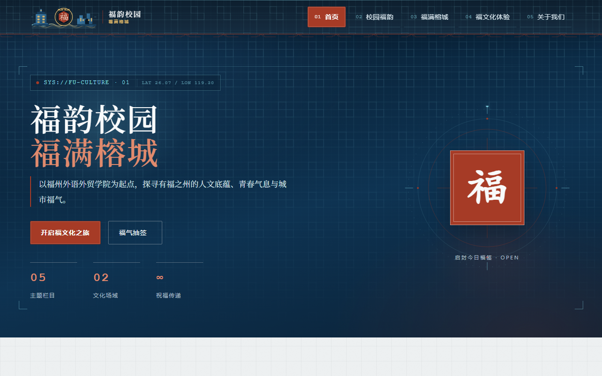

# 福韵校园 · 福满榕城

福州外语外贸学院福文化主题网站：以数字文化刊物呈现校园与福州的人文风貌，并提供轻量的福文化互动。



## 功能

- 五个栏目：首页、校园福韵（建筑 / 风景 / 活动）、福满榕城、福文化体验、关于我们
- 四组互动：每日福签、点亮五盏福灯、翻牌问俗、在线祝福墙
- 福气值每日重置，互动按天去重，祝福墙内容持久化到 MySQL
- 响应式布局，WebP 多尺寸图片，字体自托管，前端零框架依赖

## 技术栈

| 层 | 技术 |
| --- | --- |
| 前端 | HTML5 / CSS3 / 原生 JavaScript |
| 后端 | Spring Boot 3.5 / Java 17 / MyBatis |
| 数据库 | MySQL 8 |
| 构建 | Maven Wrapper |

## 快速开始

### 环境要求

- Java 17 或更高版本
- MySQL 8.0（Windows 服务名默认为 `MySQL80`）
- Windows（启动脚本为 `.bat`）

### 首次运行

1. 初始化数据库（会提示输入 MySQL root 密码）：

   ```bat
   fzwywm-server\init-db.bat
   ```

2. 打包后端与前端资源：

   ```bat
   fzwywm-server\build.bat
   ```

3. 本机启动：

   ```bat
   fzwywm-server\start-demo.bat
   ```

   浏览器打开 <http://localhost:8080/>。

### 局域网访问

1. 右键以管理员身份运行 `fzwywm-server\open-firewall.bat`，放行 8080 端口（只需一次）。
2. 双击 `fzwywm-server\start-lan.bat`，窗口会打印 `http://192.168.x.x:8080/`。
3. 同一网络下的设备访问该地址，保持窗口开启。

> 校园或公共 Wi-Fi 可能开启客户端隔离，此时同一 Wi-Fi 下也无法互访，建议用手机热点验证。

## 配置

默认配置位于 `fzwywm-server/src/main/resources/application.yml`，可通过环境变量覆盖：

| 环境变量 | 默认值 | 说明 |
| --- | --- | --- |
| `FZWYWM_PORT` | `8080` | HTTP 端口 |
| `FZWYWM_ADDRESS` | `0.0.0.0` | 监听地址 |
| `FZWYWM_DB_URL` | `jdbc:mysql://127.0.0.1:3306/fzwywm...` | 数据库连接 |
| `FZWYWM_DB_USER` | `fzwywm` | 数据库账号 |
| `FZWYWM_DB_PASSWORD` | 本地演示默认值 | 数据库密码 |

本地覆盖方式：复制 `fzwywm-server/config.local.bat.example` 为 `config.local.bat`，取消注释后修改。`config.local.bat` 已被 `.gitignore` 排除，不会进入仓库。

## 接口

| 方法 | 路径 | 作用 |
| --- | --- | --- |
| GET | `/api/health` | 健康检查 |
| GET | `/api/stats` | 祝福、点灯、抽签、访客统计 |
| GET | `/api/blessings?page=&size=` | 分页读取祝福墙 |
| POST | `/api/blessings` | 发布祝福，并自动发放当日留言福气（每日一次） |
| GET | `/api/fortune` | 当前访客的福气值与互动状态 |
| GET | `/api/fortune/daily` | 今日福签 |
| POST | `/api/fortune/actions` | 抽签 / 点灯 / 翻牌加分 |

留言加分随祝福发布自动完成，不再单独调用 `BLESS`。访客通过 `FY_VISITOR` Cookie 识别，无需登录。

## 目录结构

```text
fzwywm/            前端页面、CSS、JS、图片与字体
fzwywm-server/     Spring Boot 后端、SQL 与启动脚本
_image-originals/  原始图片素材
_shots/            页面截图
```

## 说明

- 项目按匿名访客设计，不包含登录、用户体系和管理后台。
- `blessing.status` 预留了审核字段，目前没有对应的管理接口。
- 数据库默认密码仅用于本地演示，公开部署前请修改。
- 当前主要面向本机或局域网演示；公网访问需要额外的隧道或云服务器。
